# Morning report — skins night 2026-10-26

Goal: three new skins next to Dot (Night City, Rewind, Thinker), selectable in Settings, Dot stays
the default. Previous report (2026-10-17 overnight build): `docs/reports/2026-10-17-overnight.md`.

## Summary

**Done: all three new skins are merged and pushed to `main` (last merge `ff374a3`).** Night City, Rewind and Thinker
can be chosen in Settings › Appearance; **Dot stays the default** and looks pixel-identical to before on
every page (checked by screenshot diff; only Settings changed, because it now shows four tiles).
`bun run check`: 1463 tests green. 0 BLOCKED.

- Each skin has its own wallpapers (freely licensed photos, credited), fonts, card shapes, chart
  styling, cursor, entrance/switch animations, random ambient loops in free space, and a reduced-motion
  static version. Effects load only for the chosen skin (own JS chunk, 13–19 KB) and never block clicks.
- **Deployed** to the VM `server` at your request (relayed by another session): commit `ff5ae37`,
  server healthy, all three skin chunks and wallpapers served. Choose a skin in Settings › Appearance
  on each device.
- Every screenshot in this report uses **synthetic demo data** (new `scripts/demo-server.ts`), not your history.
- Extra fix found on the way: the Insights "+ Add Goal" button was squeezed to one letter per line on
  phones in every skin, Dot included (X1).

## Workers (step 0, tested 2026-10-26 00:40–01:10)

| Worker | Command | Test |
|---|---|---|
| Codex CLI 0.164.0 | `codex --search exec -m gpt-6.1-sol -c model_reasoning_effort="high" -s workspace-write -c sandbox_workspace_write.network_access=true …` in `scripts/jail.sh` | jailed: wrote a file, `bun --version`, `curl`, web search, `exec resume <id>` |
| opencode v2.1.4 | `opencode run --standalone --auto --format json --model agentrouter-responses/gpt-6.1-sol#high` in the jail | jailed: wrote a file, `bun --version`, `--session <id>` continue |
| Antigravity 1.4.7 | `antigravity -p … --model gemini-3.8-flash-high --output-format json` in the jail | jailed: wrote a file; quota 5 h 100 %, weekly 99.5 % |

Review tool: `scripts/shots.ts` (headless Chromium over CDP): screenshots per page at 1440 px and
390 px @2x, an animation frame sequence + animated WebP, and two automatic checks: sideways overflow
and controls whose centre is covered by another element (compared with a Dot baseline).

## Skin: Night City (`nightcity`) — DONE

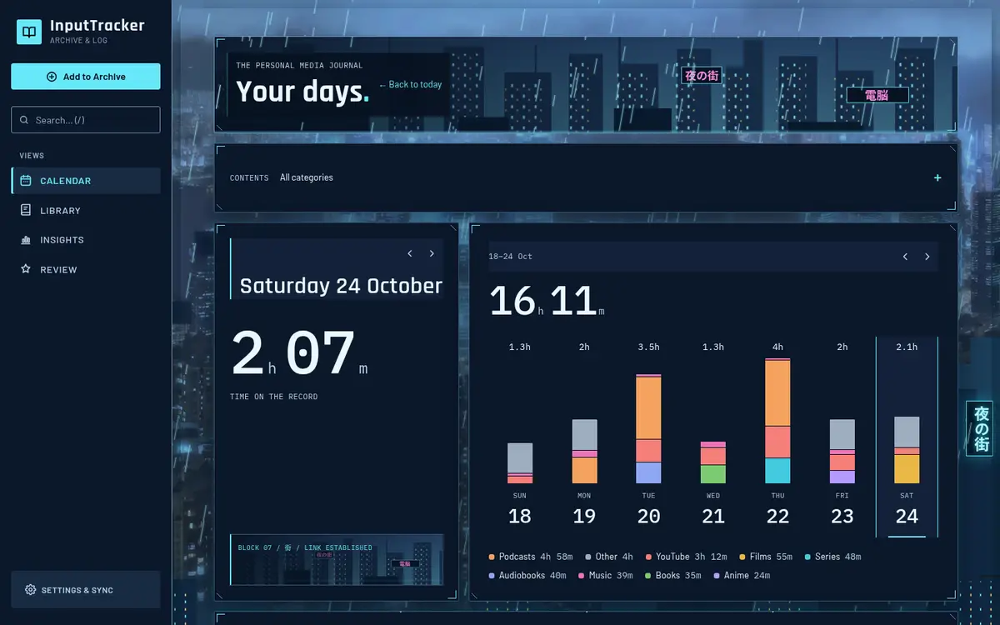

| Home (phone) | Insights (phone) | Settings (phone) |
|---|---|---|
| 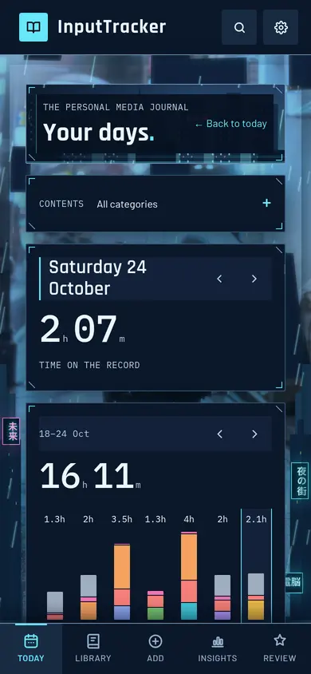 | 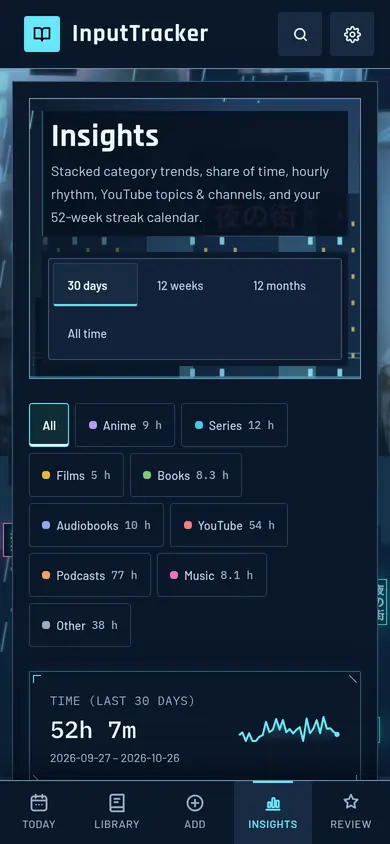 | 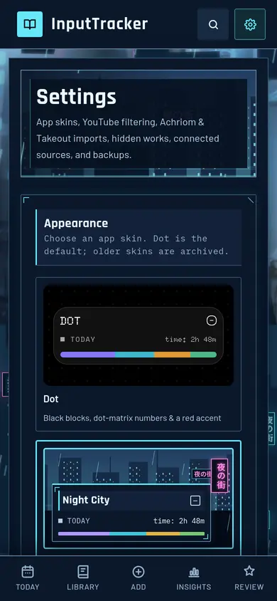 |

Desktop: [Insights](docs/skins/nightcity/insights-desktop.webp) · [Settings](docs/skins/nightcity/settings-desktop.webp) · [Add](docs/skins/nightcity/add-desktop.webp)

A rain-soaked city after midnight: deep navy, neon cyan with a few pink signs, holographic HUD
cards with cyan corner brackets and cut corners, Rajdhani headings, Barlow body, IBM Plex Mono
readouts. Every page header is a "window" onto the skyline with lit towers and neon signs;
Japanese text (夜の街, 電脳, 未来 …) is decoration only, every real label is English.

- **Signature effect — the city terminal comes online:** on every page change the card frames
  flicker on like holograms with a scanline sweep, bars and the month skyline grow up from the
  baseline with a cyan scan, sparklines draw in, and big numbers HUD-decode (glyph scramble ending
  on the exact value, on a decorative copy; the real number stays in the page for screen readers)
  ([frames 70 ms apart](docs/skins/nightcity/entrance-frames.webp)). Day/week/month switches sweep a
  rail across the changed card in the direction of travel ([day switch](docs/skins/nightcity/day-switch-frames.webp)).
- **Rain past the cards, always:** continuous rain behind the cards (visible in the gutters, the gaps
  and the header city windows) with heavier bursts every 20–40 s, drops beading and running down the
  card frames and tiny splashes on their top edges — never over text
  ([rain close-up](docs/skins/nightcity/rain-detail.webp) · [animation](docs/skins/nightcity/rain.webp) · [phone](docs/skins/nightcity/rain-phone.webp)).
- **Ambient loops** (free space only, max 2 at once / 1 on phone): a neon sign buzzing on, a drone's
  lights passing along an edge, a train's lit windows gliding by, a puddle ripple, a hologram ad
  glitching, a rooftop beacon breathing.
- **Cursor:** a cyan-outlined dark arrow (normal), the same with HUD brackets at the heel (pointer), a
  cyan I-beam (text), with a small heel glow on desktop.
- **Wallpapers:** Hong Kong night skyline (Base64, CC BY-SA 3.0 — derivative shared under the same
  licence) for desktop, "Alone in Tokyo III" (Romain Guy, CC0) for phones, both graded toward an anime
  night background (logos replaced), plus code-drawn SVG skyline silhouettes and signs. I chose freely
  licensed photos graded to an anime look over anime screenshots, which can't be redistributed.
  Credits: `web/public/wallpapers/nightcity/CREDITS.md`.
- **Workers:** brief NC-a Codex (1 send-back: constant rain, livelier motion, a skyline wallpaper);
  base NC-b Codex; animations NC-c Codex (1 send-back: rain invisible, entrances not visible, gibberish
  sign glyphs; the revision was paused by the Codex usage limit 03:42–06:52 and resumed in the same
  session); Settings tile/tests/docs NC-d Codex (1 send-back: the NC-c effects code was written in a dense
  minified-looking style; reformatted to the repo's normal style, behaviour unchanged).
- Checks: overflow 0 everywhere; covered controls only items under the phone tab bar; rain changes
  ~2,000–3,400 pixels per frame, none over text or controls.

## Skin: Rewind (`rewind`) — DONE

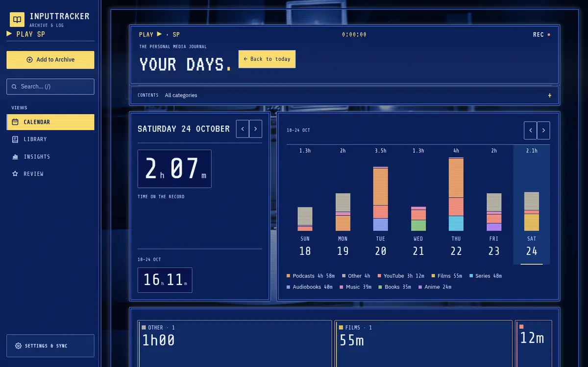

| Home (phone) | Insights (phone) | Settings (phone) |
|---|---|---|
| 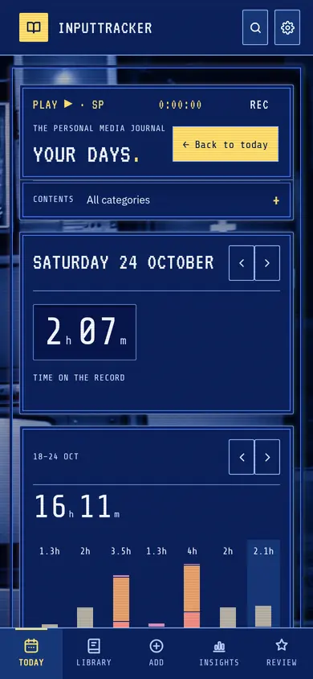 | 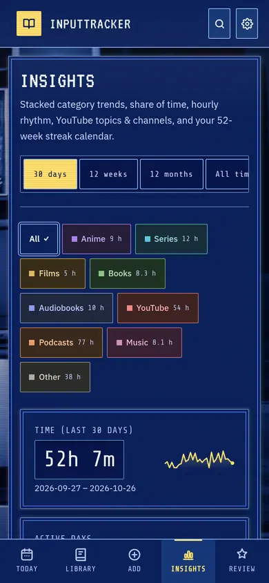 | 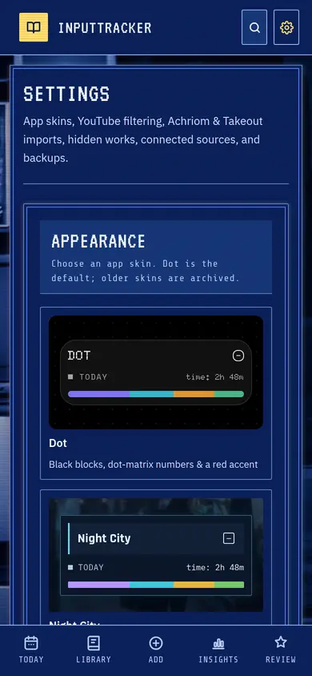 |

Desktop: [Insights](docs/skins/rewind/insights-desktop.webp) · [Settings](docs/skins/rewind/settings-desktop.webp)

**Look chosen: A, blue VCR menu (shown on a CRT).** The worker built all three looks quickly
([side by side](docs/skins/rewind/three-looks-compared.webp): A blue VCR, B black CRT, C warm home
video). I kept A because the blue screen with yellow selection strips is the most instantly
recognisable VHS image; B read at a glance like Dot (black) with a mint accent; C's warm palette
overlaps Thinker's firelight. A keeps B's best parts: static scanlines, an RGB glow on the outside of
the frames and a dark vignette. (The worker had recommended B.)

- **Signature effect — tracking lock:** switching day, week or month makes the changed cards slip in
  2–4 horizontal slices with an RGB fringe for ≤ 240 ms, the wallpaper bands slide, ◀◀/▶▶ streaks
  race through the margins and an OSD plaque flips `TRACKING` → `PLAY ▶`. Data updates immediately
  underneath; clicks are never blocked. [Frames 50 ms apart](docs/skins/rewind/tracking-glitch-frames.webp) ·
  [animation](docs/skins/rewind/tracking-glitch.webp).
- **Always on:** faint full-screen scanlines with a slow rolling bright band, `REC ●` blinking in the
  Home masthead, `PLAY ▶ SP` and a tape counter as decoration; big numbers roll like a mechanical tape
  counter when they appear or change; cards "acquire signal" (a noise band) when they enter.
- **Ambient loops** (now and then, only in free space, max 2 at once / 1 on phone): `TRACKING` OSD
  fading in, a VHS dropout line rolling through empty wallpaper, head-switching noise at the bottom
  edge, rewind streaks, a reel glint, a phosphor afterglow speck.
- **Cursor:** a white OSD arrow with a navy outline, the same with a yellow ▶ notch (pointer), a slim I-beam; tiny phosphor beads trail
  behind it in empty gutters (desktop only).
- **Wallpaper:** a wall of old TVs (Unsplash licence, Liana S.), tinted VCR blue; fonts VT323, Share
  Tech Mono, IBM Plex Sans (OFL). Credits: `web/public/wallpapers/rewind/CREDITS.md`.
- **Workers:** brief RW-a opencode (Sol high, 1 send-back for livelier motion); base RW-b Codex
  (opencode was rate-limited before it started) incl. the three-look comparison; animations RW-c
  Codex; Settings tile/tests/docs RW-d started on Codex, cut by Codex's usage limit, finished by
  Antigravity.
- Checks: overflow 0 on all pages at 1440 and 390 px; no control covered beyond Dot's own (the
  phone tab bar over list items); `bun run check` green.

## Skin: Thinker (`thinker`) — DONE

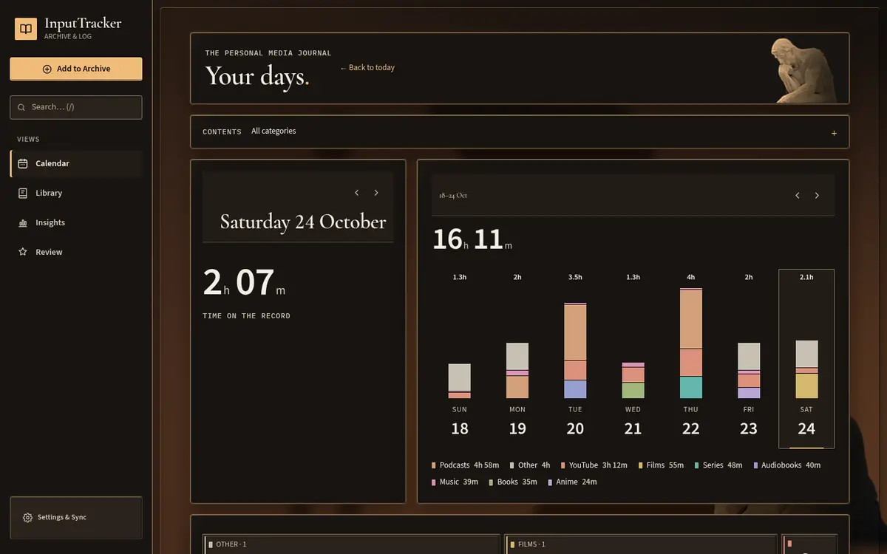

| Home (phone) | Insights (phone) | Settings (phone) |
|---|---|---|
| 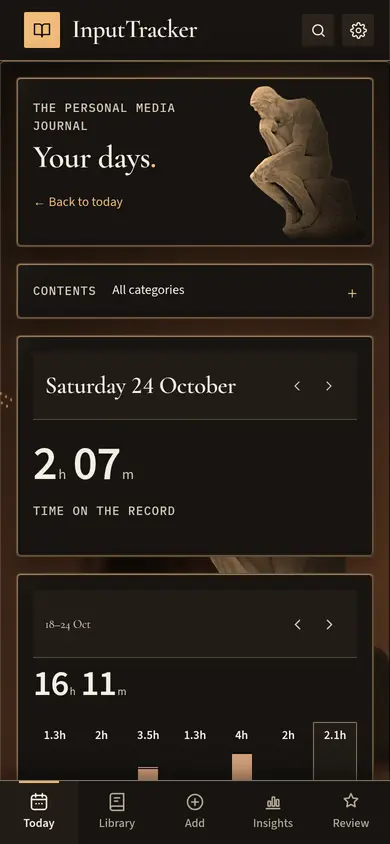 | 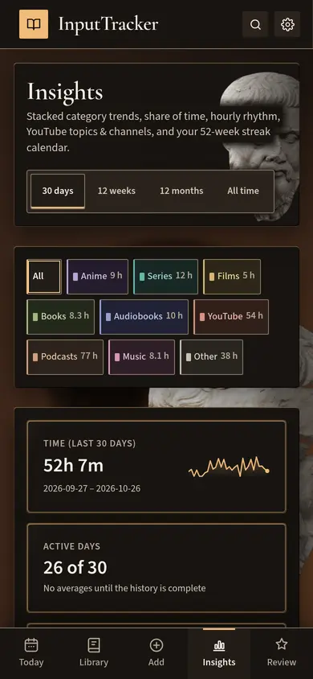 | 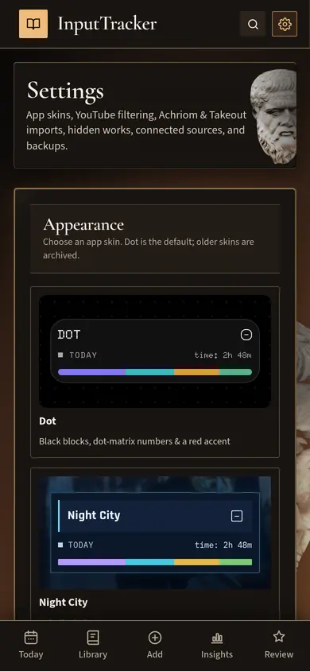 |

Desktop: [Insights](docs/skins/thinker/insights-desktop.webp) · [Settings](docs/skins/thinker/settings-desktop.webp)

A soot-dark cave: pale marble and plaster statues (Rodin's The Thinker, Plato, Victor Hugo) lit
warmly from one low side by an unseen fire; each page family has its own statue (Home = Thinker,
Library/work/Review = Hugo, Insights/Settings/Search/Add = Plato). Cards are stone slabs with bronze
bevels and mineral-inlay charts; Cormorant Garamond headings, Source Sans 3 numbers, IBM Plex Mono
dates. No quotes anywhere.

- **Signature effect — firelight and moving shadows:** one shared three-band flame model drives the
  warm light on the statues, a flickering rim light on every card's bevel, the direction of the card
  shadows and huge statue shadows that breathe and sway on the cave wall behind the content
  ([animation, desktop](docs/skins/thinker/firelight.webp) · [phone](docs/skins/thinker/firelight-phone.webp)).
  Switching day/week/month sends a torch pass across the changed card while the wall shadows lean
  that way.
- **Motion:** chart stacks rise from the stone baseline and big numbers "ignite" with a warm glow on
  every page entry ([entrance frames, 70 ms apart](docs/skins/thinker/entrance-frames.webp)).
- **Ambient loops** (only in empty wall space, one at a time): ember bursts rising from the bottom
  edge, a shadow figure walking across the cave wall, a flame gust brightening one side, dust in a
  light shaft, a hearth flame tongue, drifting soot, a marble glint.
- **Cursor:** a marble-white arrow with a warm facet and an ember tip (normal), the same with a small
  flame spark (pointer), an I-beam with amber caps (text); small glowing motes trail it in empty
  gutters (desktop only).
- **Images:** The Thinker (plaster cast, The Met, CC0), Victor Hugo bust (Musée Rodin, CC0, Jebulon),
  Plato (CC BY-SA 4.0, Osama Amin — the derivative is shared under the same licence); cut out and
  relit locally. Credits: `web/public/wallpapers/thinker/CREDITS.md`.
- **Workers:** brief TH-a opencode (1 send-back for fire on the cards and bigger shadows); base TH-b
  opencode (1 AgentRouter restart); firelight/motion TH-c opencode (1 send-back for a flat, unlit
  Thinker cut-out and tall phone headers; 5 AgentRouter stops — after the 3rd in a row, with Codex
  limited and opencode rate-limited, Antigravity finished the Home masthead); Settings tile/tests/docs
  TH-d Antigravity (1 send-back: phone masthead crop, reverted an unneeded layout change).
- Checks: overflow 0 everywhere; covered controls only the usual items under the phone tab bar;
  `bun run check` green. A late polish task (X2, Antigravity) restored the full busts in the desktop
  page headers (they had been cropped to a sliver by the phone header fix).

## Done

| task | worker | model | attempts | commit |
|---|---|---|---|---|
| S0 skin effects layer + stub skins | Codex | gpt-6.1-sol high | 1 | 6cbb5e5 |
| D0 demo server (synthetic data) | Antigravity | gemini-3.8-flash-high | 1 + 1 send-back | 984c090 |
| NC-a Night City brief | Codex | gpt-6.1-sol high | 1 + 1 send-back | ae1d00f |
| NC-b Night City base | Codex | gpt-6.1-sol high | 1 | 7ead66d |
| NC-c Night City animations | Codex | gpt-6.1-sol high | 1 + 1 send-back (paused by usage limit) | e264eb9 |
| NC-d Night City tile/tests/docs | Codex | gpt-6.1-sol high | 1 + 1 send-back | ff374a3 |
| RW-a Rewind brief (3 looks) | opencode | agentrouter-responses/gpt-6.1-sol#high | 1 + 1 send-back | 9b69b05 |
| RW-b Rewind base + look comparison | Codex (opencode rate-limited) | gpt-6.1-sol high | 1 (2 phases) | 9f29ae4 |
| RW-c Rewind animations | Codex | gpt-6.1-sol high | 1 | 2f7ac8e |
| RW-d Rewind tile/tests/docs | Codex → Antigravity (Codex limit) | gemini-3.8-flash-high | 1 | f37daf8 |
| TH-a Thinker brief | opencode | agentrouter-responses/gpt-6.1-sol#high | 1 + 1 send-back | 1ab5f34 |
| TH-b Thinker base | opencode | agentrouter-responses/gpt-6.1-sol#high | 1 (1 AgentRouter restart) | 2871fd0 |
| TH-c Thinker firelight/motion | opencode → Antigravity (finish) | gpt-6.1-sol#high / gemini-3.8-flash-high | 1 + 1 send-back (5 AgentRouter stops) | 822e8a3 |
| TH-d Thinker tile/tests/docs | Antigravity | gemini-3.8-flash-high | 1 + 1 send-back | fff833f |
| X1 card header buttons (all skins) | Antigravity | gemini-3.8-flash-high | 1 | 4184468 |
| X2 Thinker desktop header busts | Antigravity | gemini-3.8-flash-high | 1 | 6fbffb0 |

## Failed / sent back

- NC-a, RW-a, TH-a (briefs): each sent back once for livelier motion; all accepted on the revision.
- NC-c attempt 1: rain practically invisible (≈20 px changed per second), no visible entrances on route change, gibberish neon glyphs. Revision cut by the Codex usage limit (03:42), resumed 06:52 in the same session, accepted.
- NC-d: Night City effects code was written in a dense minified-looking style; reformatted (no behaviour change).
- D0: demo config left external cover/metadata lookups on; switched off so the demo server stays offline.
- TH-d: phone masthead crop still wrong and an unneeded layout change; fixed on the revision.
- RW-b: not a failure — phase 1 built three looks on purpose; the manager picked A and sent phase 2.
- TH-c attempt 1: Thinker cut-out flat and unlit, phone headers inflated to ~600 px by the statues. Sent back to the same opencode session; Antigravity finished the last step after AgentRouter's 3rd stop in a row.

## BLOCKED

None.

## AgentRouter restarts

| task | time | what happened | action |
|---|---|---|---|
| TH-b | 03:07 | opencode exited with "different Azure OpenAI resource" (router moved the session; stored items gone) | `run-worker-retry.sh` restarted fresh with the same prompt + "continue from the files on disk"; finished 03:22, not counted as an attempt |
| TH-c | 03:48 | opencode stopped mid-task: `provider.invalid-request` "Upstream rejected the request as invalid" (after a tool-calls step) | continued the same session with "continue where you stopped" (restart 1) |
| TH-c | 03:58 | opencode exited with "different Azure OpenAI resource" right after the continue | restarted fresh with the prompt + "continue from the files on disk" (restart 2); finished 04:13 |
| TH-c | 04:28 | revision run stopped mid-way: `provider.invalid-request` "Upstream rejected the request as invalid" | continued the same session (restart 3 overall; first in a row since the 04:13 finish) |
| TH-c | 04:30 | the continue was rejected immediately (`Upstream rejected the request as invalid`, session history unusable) | fresh opencode session with the prompt + review + "continue from the files on disk" (2nd stop in a row) |
| TH-c | 04:40 | fresh session lost again (router switched Azure resource), then `rate_limit_exceeded` on gpt-6.1-sol — **3rd stop in a row** | by the rule this goes to Codex, but Codex is limited until 06:51 and opencode is rate-limited: the small remaining step (Home masthead statue) went to Antigravity with a note of what is done |

## Limit pauses

| worker | model | hit at | recovered at | message |
|---|---|---|---|---|
| codex | gpt-6.1-sol high | 2026-10-26 03:42 (NC-c revision, RW-d) | 06:52 (probe OK) | `You've hit your usage limit … try again at 6:51 AM.` RW-d moved to Antigravity with the partial work kept; NC-c revision resumed 06:52 in the same session and was accepted. Not counted as attempts. |
| opencode | agentrouter-responses/gpt-6.1-sol#high | 2026-10-26 02:20–02:27 (RW-b, 3 retries 90 s apart) | — | `rate_limit_exceeded: … gpt-6.1-sol in eastus2 have exceeded token rate limit` (no reset time given). Probe at 02:42 OK. RW-b moved to Codex before any work was done; not counted as an attempt. |

## Decisions needed

1. ~~Deploy to the VM~~ — done: `scripts/deploy-vm.sh server` deployed `ff5ae37` (the live VM is
   `server`). Rollback if ever needed: deploy commit `b2d23f1` (yesterday's build) from a detached
   worktree with the same script.
2. **Image licences:** two wallpapers are CC BY-SA (Hong Kong skyline 3.0, Plato bust 4.0). Their
   edited versions are therefore also CC BY-SA, with credit in the CREDITS.md files. Fine for a
   private app; if you ever publish the repo, keep those credit files.
3. Optional: old worktrees from 2026-10-20 (D1, T1, T2, W16, W18) are still in `.worktrees/`; I left
   them alone because they aren't from this task.

## Notes for next time

- AgentRouter (opencode) stopped TH-c five times ("Upstream rejected the request as invalid", the
  router switching Azure resource) and rate-limited Sol twice. `scripts/run-worker-retry.sh` now
  handles the "Upstream rejected" stop (continue once, then restart fresh from the files on disk).
- Codex hit its ChatGPT usage limit at 03:42 after about 2½ hours (01:20–03:42) of mostly two parallel sessions; reset at 06:51.
- `scripts/shots.ts` (screenshots + frame captures + covered-control/overflow checks) and
  `scripts/demo-server.ts` (synthetic data) are the review tools; see WORKERS.md / README.
